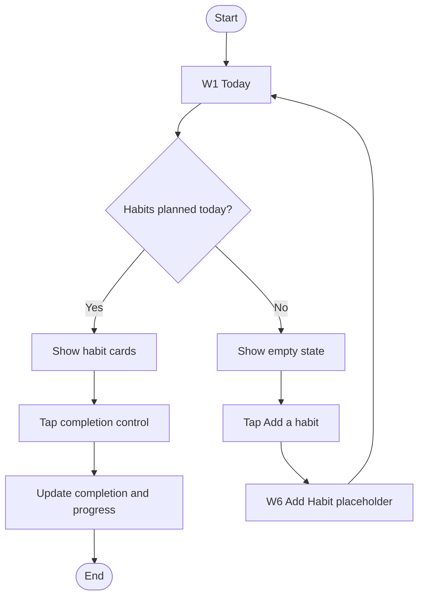
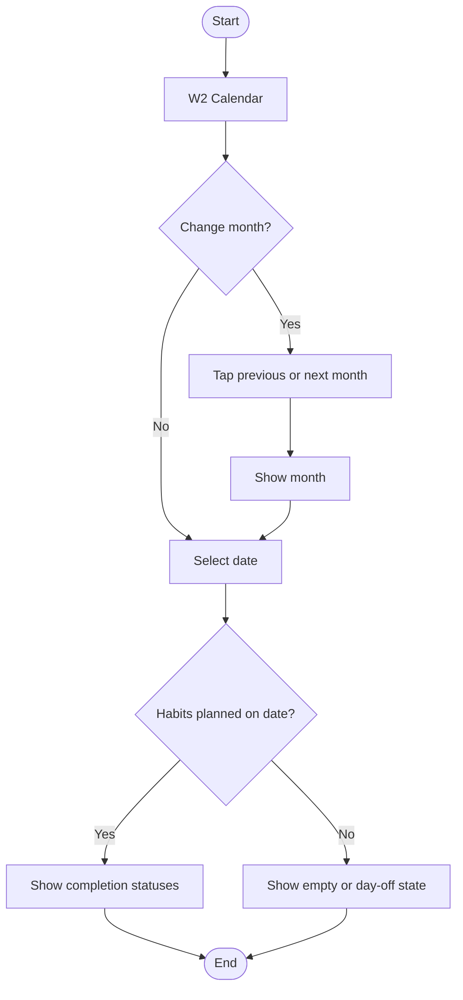
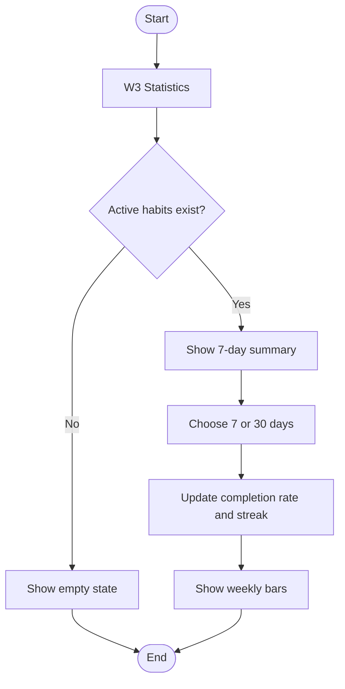
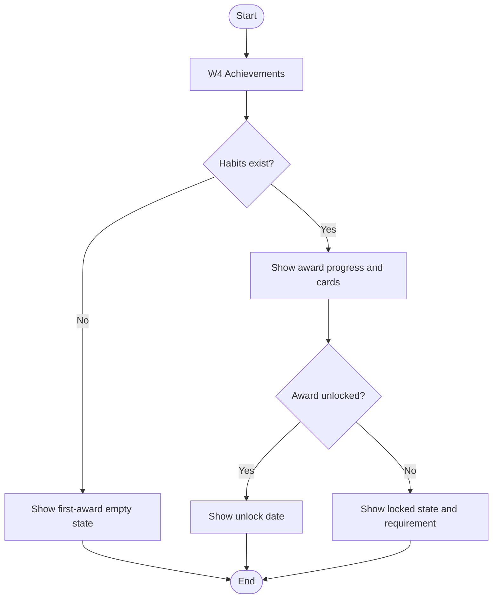
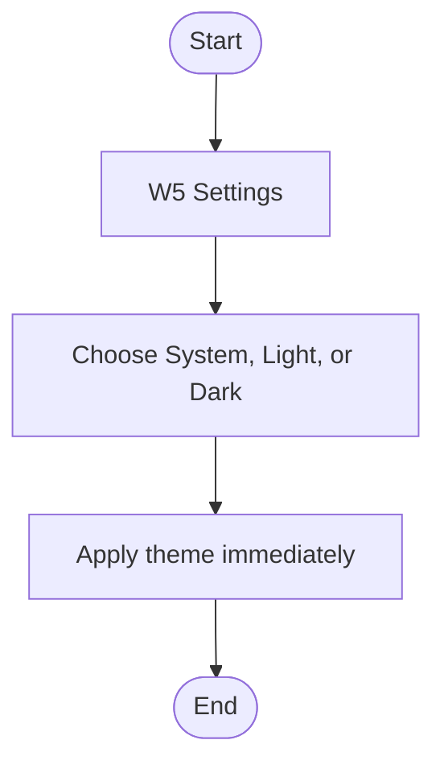
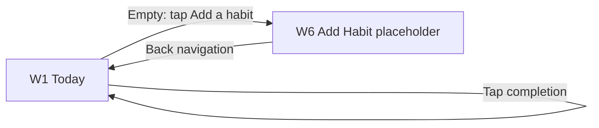
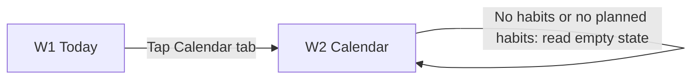
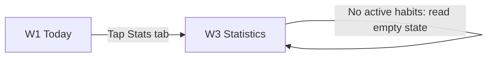
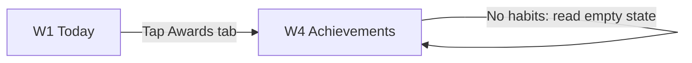
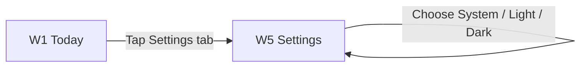

# Milestone 3 — UI Specification

This specification describes the current Member B interface. The Milestone 1 user stories were not available when it was written, so Goals A–E are provisional and must be mapped to the original story IDs before submission. This is a specification artifact; it does not add Flutter behavior.

## Conventions and scope

- Wireframes are monochrome and focus on structure and controls.
- `[...]` indicates an interactive control; `{...}` indicates data-driven content.
- W1–W5 include the persistent Today / Calendar / Stats / Awards / Settings navigation.
- Empty states are alternative paths. The current app has no service-backed loading or error UI.
- W6 is the existing Add Habit handoff placeholder; adding a habit is outside Member B's implemented scope.

## User flows

### Goal A — Review and complete today's habits



Alternative: no habits are scheduled; the empty state links to the placeholder Add Habit screen.

### Goal B — Review activity on a date



Alternative: no active habits or no habits scheduled for the selected weekday.

### Goal C — Check statistics



Alternative: no active habits; the summary and chart are replaced by an explanatory empty state.

### Goal D — Review achievements



Alternative: no habits exist, so only the empty state is shown.

### Goal E — Change appearance



Alternative: keep the current selection. The current theme choice applies only during the app session.

## Low-fidelity wireframes

### W1 — Today

```text
+------------------------------------------------+
| Habit Tracker                              (○) |
+------------------------------------------------+
| Good morning                                   |
| {Weekday, Month DD}                            |
| +--------------------------------------------+ |
| | Today's progress                    {x / y} | |
| | [==============================          ] | |
| | {progress message}                          | |
| +--------------------------------------------+ |
| +--------------------------------------------+ |
| | Current streak                         {n} | |
| | {streak message}                            | |
| +--------------------------------------------+ |
| Today's habits                         {count} |
| [icon] {Habit title}          [○ / ✓ toggle]   |
| {description or streak}                       |
| Empty: A fresh start · [ + Add a habit ]       |
+------------------------------------------------+
| [Today] [Calendar] [Stats] [Awards] [Settings] |
+------------------------------------------------+
```

Controls: habit completion toggle, Add a habit action, pull-to-refresh, and bottom navigation.

### W2 — Calendar

```text
+------------------------------------------------+
| Calendar                                       |
| Your consistency, at a glance                 |
| +--------------------------------------------+ |
| | [<]              {Month YYYY}           [>] | |
| |  M    T    W    T    F    S    S            | |
| | {01} {02} {03} {04} {05} {06} {07}          | |
| | {08} {09} {10} {11} {12} {13} {14}          | |
| | {15} {16} {17} {18} {19} {20} {21}          | |
| | {22} {23} {24} {25} {26} {27} {28}          | |
| | {29} {30} {31}  • = completed               | |
| +--------------------------------------------+ |
| {Selected date}                       {x / y} |
| {Habit}                           {status}     |
| Empty: no habits / day off                     |
+------------------------------------------------+
| [Today] [Calendar] [Stats] [Awards] [Settings] |
+------------------------------------------------+
```

Controls: previous/next month buttons and selectable dates.

### W3 — Statistics

```text
+------------------------------------------------+
| Statistics                                     |
| Small wins add up. Here is your progress.      |
| [ 7 days ] [ 30 days ]                         |
| +--------------------------------------------+ |
| | Completion rate                       {x%} | |
| | [==============================          ] | |
| | {completed} of {planned} habit-days       | |
| +--------------------------------------------+ |
| | Current streak                         {n} | |
| | {streak message}                            | |
| +--------------------------------------------+ |
| Last 7 days · {daily completion bars}          |
| Empty alternative: Your progress starts here   |
+------------------------------------------------+
| [Today] [Calendar] [Stats] [Awards] [Settings] |
+------------------------------------------------+
```

Controls: 7-day/30-day selector. Weekly bars are informational.

### W4 — Achievements

```text
+------------------------------------------------+
| Achievements                                   |
| Celebrate the effort behind every streak.      |
| Awards unlocked                          {x/y} |
| [==============================              ] |
| Your achievements                             |
| +--------------------------------------------+ |
| | [trophy/lock] On Fire                       | |
| | Complete 3 planned days in a row.           | |
| | {Habit} · {unlock date / required streak}    | |
| +--------------------------------------------+ |
| | [trophy/lock] Week Warrior                  | |
| | Complete 7 planned days in a row.           | |
| | {Habit} · {unlock date / required streak}    | |
| +--------------------------------------------+ |
| Empty alternative: Your first award is waiting |
+------------------------------------------------+
| [Today] [Calendar] [Stats] [Awards] [Settings] |
+------------------------------------------------+
```

### W5 — Settings

```text
+------------------------------------------------+
| Settings                                       |
| Make your space feel right for you.            |
| +--------------------------------------------+ |
| | Appearance                                  | |
| | Choose how Habit Tracker looks on device.   | |
| | [ System ] [ Light ] [ Dark ]              | |
| +--------------------------------------------+ |
| | Habit Tracker · Build better days...        | |
| +--------------------------------------------+ |
+------------------------------------------------+
| [Today] [Calendar] [Stats] [Awards] [Settings] |
+------------------------------------------------+
```

Controls: System, Light, and Dark theme choices.

### W6 — Add Habit handoff

```text
+------------------------------------------------+
|                                                |
|                  Add habit                    |
|          (placeholder; no form controls)       |
|                                                |
+------------------------------------------------+
```

## Combined wireframe flows











## Widget decomposition

| Screen | Sections/widgets |
|---|---|
| Home shell | `Scaffold`, `IndexedStack`, `NavigationBar` |
| W1 Today | `AppBar`, greeting/date, `ProgressCard`, `StreakCard`, habit count, `HabitCard` list or `EmptyState` |
| W2 Calendar | `AppBar`, `CalendarWidget`, date heading/count, habit tiles or `EmptyState` |
| W3 Statistics | `AppBar`, range selector, `ProgressCard`, `StreakCard`, weekly bars or `EmptyState` |
| W4 Achievements | `AppBar`, `ProgressCard`, `AchievementCard` list or `EmptyState` |
| W5 Settings | `AppBar`, appearance card and theme selector, app identity card |
| W6 Add Habit | Placeholder `Scaffold` and centered label; actual form is not implemented |

## Reusable widgets

All components below live in the shared `lib/widgets/` folder.

| Widget | Screens | Parameters |
|---|---|---|
| `ProgressCard` | Today, Statistics, Achievements | `title`, `value`, `subtitle`, `progress`, `icon` |
| `StreakCard` | Today, Statistics | `streak`, `subtitle` |
| `EmptyState` | Today, Calendar, Statistics, Achievements | `icon`, `title`, `message`, optional `actionLabel`, optional `onAction` |

`CalendarWidget` is shared from `lib/widgets/` and used by Calendar; parameters: `month`, `selectedDate`, `completionDates`, `onMonthChanged`, `onDateSelected`.

## Alignment notes

1. Map Goals A–E to the exact Milestone 1 story IDs and verify no stories are missing.
2. W6 is a placeholder handoff; habit creation is not implemented here.
3. If persistence or service loading is added, document its loading and error states separately.
